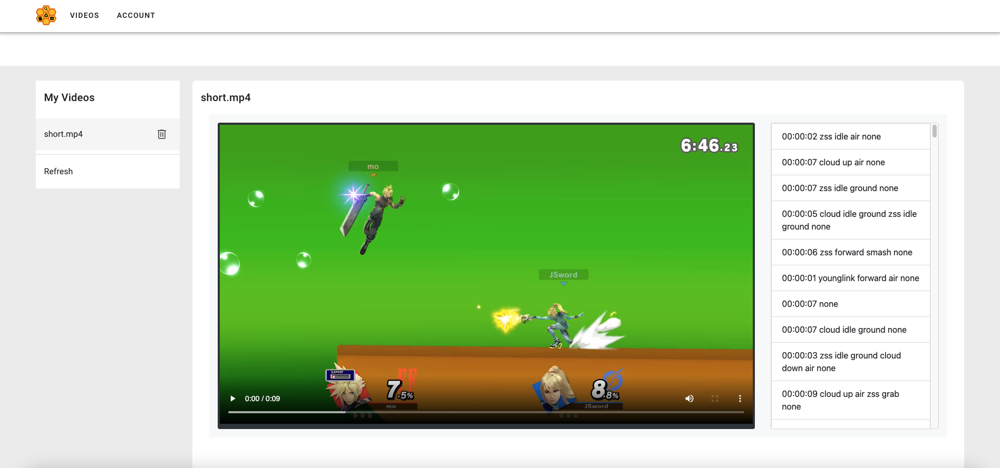
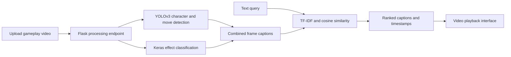

# CombVCS — Combined Video Captioning and Search

CombVCS is a capstone prototype for finding moments in **Super Smash Bros. gameplay videos using text queries**. It combines computer vision with information retrieval: detected characters, moves, and visual effects become frame captions that can be searched from a web interface.

For example, a query such as `cloud forward air` is compared with captions describing the detected action. The interface presents matching captions and clickable timestamps beside the video.

**Project status:** historical research prototype, curated for source review. Full video processing requires separately supplied trained models and a compatible Darknet build. This repository does not include those binaries or the training footage. The original retrieval and timestamp algorithms are preserved; see [known limitations](docs/LIMITATIONS.md) before attempting a demonstration.

## Capstone poster and report

University of Arkansas–Fort Smith · Computer Science Capstone · Spring 2022.

[](docs/archive/poster.png)

[Full-resolution poster](docs/archive/poster.png) · [Original project report (PDF)](docs/archive/CombVCS-report-2022.pdf) · [Archive and editable report source](docs/archive/README.md)

### Historical application screenshot



This screenshot is preserved from the original project report; it is not a new runtime verification.

## What the project implements

- A Vue 2 / Vuetify interface for uploading, listing, selecting, and deleting videos.
- A Flask API that coordinates video processing, search, and playback.
- A custom YOLOv3 detector for character/action labels.
- A TensorFlow/Keras convolutional model for visual effect classification.
- Frame captions ranked by TF-IDF and cosine similarity, with a `0.5` similarity cutoff.
- Training notebooks showing the detector workflow and effect classifier experiments.

The search is vocabulary-based retrieval over detected labels. It does not use speech transcription, embeddings, or a general-purpose vision-language model.

## How it works



## Repository guide

| Path | Purpose |
| --- | --- |
| `web/combvcs/` | Vue frontend, dependencies, and build configuration |
| `web/server/app.py` | Flask routes, detection orchestration, captions, retrieval |
| `web/server/effect_detector.py` | Frame-by-frame effect inference |
| `web/server/darknet/` | Project detector configurations and class labels only |
| `notebooks/` | Training notebooks with saved outputs removed |
| `docs/archive/` | Original poster, report, editable source, and historical figures |
| `docs/SETUP.md` | Local setup and required external model artifacts |
| `docs/ARCHITECTURE.md` | Pipeline, API, and data format |
| `docs/CURATION.md` | Included files, exclusions, and preparation changes |
| `docs/LIMITATIONS.md` | Reproducibility and implementation limitations |

## Getting started

The frontend can be built independently:

```sh
cd web/combvcs
npm ci
npm run build
npm run serve
```

The development UI opens at `http://localhost:8080`; API calls target `http://127.0.0.1:32001`. Uploading and searching require the backend and model artifacts. Follow the [complete setup guide](docs/SETUP.md) for those prerequisites.

## Engineering focus

This code demonstrates the integration of model training, frame-level inference, structured metadata, classical text retrieval, HTTP APIs, and a video-oriented interface. The archived report contains historical experiments and training-loss plots. Those results have not been reproduced for this curated version, so no new accuracy, latency, or dataset-size claims are made here.

## Credits and provenance

**Capstone team:** An Le, Jordan Aikey, Julton Sword, Martin Tran, and Zachary Mackay. **Faculty advisors:** Andrew Mackey and Israel Cuevas. The original poster and report preserve the team attribution.

The detector uses [AlexeyAB/Darknet](https://github.com/AlexeyAB/darknet). The YOLO training notebook retains its original credit to The AI Guy. The interface uses Vue, Vuetify, Axios, and Bootstrap; backend processing uses Flask, OpenCV, TensorFlow/Keras, pandas, and scikit-learn.

Super Smash Bros. and its characters belong to their respective rights holders. Gameplay videos and training datasets are not distributed here; the archived report and its illustrative screenshots are included. See [third-party notes](THIRD_PARTY_NOTICES.md). No new project-wide license has been assigned; contributor ownership and licensing should be confirmed before granting reuse rights.
