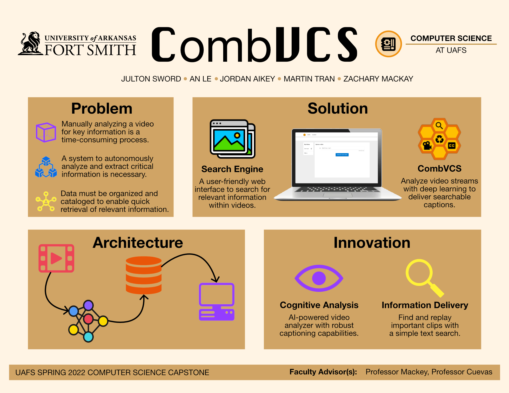

# Spring 2022 capstone archive

Original presentation and report artifacts for **CombVCS — Combined Video Captioning and Search**, University of Arkansas–Fort Smith, Spring 2022.

## Poster

[Open the full-resolution poster](poster.png).

## Report and source

- [Read the original 16-page report](CombVCS-report-2022.pdf), dated May 5, 2022 on its cover.
- [LaTeX source](report-source/Project_Proposal.tex), [bibliography](report-source/refs.bib), and all 11 referenced figures are preserved in `report-source/`.
- [Historical interface screenshot](report-source/website2.png) and [detector screenshot](report-source/yolo_in_effect.png) show the original application.

The original document retains the filename `Project_Proposal` in its source and “Capstone Proposal” in its headers, but includes experimentation, results, screenshots, and team details. It is labeled here as an archived project report, without asserting that it was the final submitted version.

The PDF and source assets are copied unchanged. With a LaTeX distribution providing the referenced packages and IEEEtran bibliography style, the original source can be built from `report-source/` using `pdflatex Project_Proposal.tex`, `bibtex Project_Proposal`, then `pdflatex` twice. This build has not been rerun. The source uses an automatic date, so rebuilding can change the cover date; the archived PDF remains the historical reference.

## Team and advisors

The poster and report credit An Le, Jordan Aikey, Julton Sword, Martin Tran, and Zachary Mackay. The report names faculty advisors Andrew Mackey and Israel Cuevas.

The report describes An Le’s planned responsibilities as training-data processing, machine-learning model development, and backend development for text-based video retrieval. Because the wording is prospective, it is not treated as a verified record of completed individual contributions.

## Interpreting historical evidence

The report contains training-loss plots and a description of human retrieval evaluation. These are historical project evidence, not a benchmark reproduced during repository preparation. Its reported 80/20 effects-data split differs from the retained notebook’s 80/10/10 split, and its YOLO training-count wording should not be treated as a verified metric. The poster’s database icon is conceptual; the curated implementation stores results in files.

The screenshots represent the 2022 interface and may differ from the current source. See [current architecture](../ARCHITECTURE.md), [limitations](../LIMITATIONS.md), and [validation](../VALIDATION.md) for the inspected implementation.

## Selection and provenance

Source archive folders: `ai-web-combvcs/` and `Project Proposal/` within the supplied Spring 2022 Capstone archive. [SHA-256 manifest](SHA256SUMS) records the unchanged copied files; paths are relative to this directory.

Excluded: duplicate tar archives (their files matched the unpacked report folder), LaTeX build intermediates, unused/duplicate illustrations, weekly status reports, an unfinished proposal template for another titled project, and the `cloud/` and `done/` training-image collections. The selected report figures retain their original citations and attribution context.
